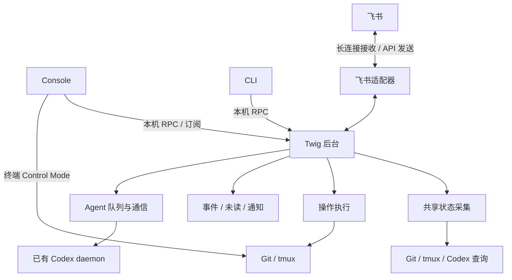

# Twig 后台整体设计

日期：2026-10-25。状态：第一版完整迁移已实现，进入 PR 验收。

本文是 [DESIGN.md](DESIGN.md) 的专题设计。已确认第一版完整迁移 Twig 业务到后台，同时交付飞书双向通信、持续运行、多入口一致和多窗口同步。实施过程按里程碑拆分，但不把部分业务仍在前台执行的中间形态作为最终版本。本文同时记录已落地的边界和验收范围，使用方式以 [README.md](README.md) 和 [后台指南](docs/daemon.md) 为准。

## 1. 目标

后台承担持续观察、可靠通信、操作执行和通知分发。Console、CLI、飞书共享业务状态；关闭界面不停止已接受的后台工作，也不中断完成事件采集。

主要收益：

- Console 打开即可读取已有快照，再获得新状态；多个窗口不重复执行同一组查询。
- 没有 Console 在线时，仍持续消费 Agent 消息队列、检查完成状态、保存未读和回复飞书。
- 项目、任务和未读的变化可以推送到各个界面，降低同步延迟与无效重绘。
- 较慢的操作可以脱离界面生命周期，提供可查询的进度和结果。
- 统一显示连接状态、采集时间、失败原因和队列积压，避免界面看似正常却停留在旧数据。

“持续可用”以宿主机器运行、网络正常和所需服务可用为前提。进程后台运行解决退出 Console 的问题；系统托管解决登录退出或机器重启后的恢复问题，不能解决机器休眠、断电的问题。

## 2. 当前实现与变化

| 当前模块/机制 | 当前职责 | 建议归属 |
| --- | --- | --- |
| `src/console/data.rs`、`query.rs` | Console 内采集 Git/tmux/Codex 状态，控制浏览查询超时 | 后台共享采集器 |
| `src/console/inbox.rs` | 未读、去重和采集进度持久化 | 后台事件与未读存储 |
| `src/console/notifications.rs` | 通知队列、查看状态及界面联动 | 持久状态归后台，卡片展示归 Console |
| `src/agent/mod.rs` | 绑定、消息持久化与投递、完成回调、飞书 webhook 通知 | 通信调度归后台，业务规则复用 |
| `src/agent/chat.rs` | 进程内通信线程，发送与历史读取 | Console 的后台客户端与展示状态 |
| CLI 生命周期操作 | 同步调用 Git/tmux 并持有资源锁 | 第一版全部交给后台，复用同一业务实现与保护规则 |
| `src/workbench.rs`、剪贴板与选区 | 终端输入、画面、复制及交互 | 继续归 Console |

迁移前约定“不运行 Twig 自有后台服务”已被本设计取代；“不启动、重启或停止共享 Codex daemon”保持不变。README、DESIGN、AGENTS 与用户手册已同步更新。

## 3. 整体架构

后台不是另一套 Agent：它只执行确定性的调度与状态管理。需求理解、任务拆分和验收仍由主控 Agent 完成。

后台不接管终端输入、终端绘制、滚动、选区、剪贴板、表单草稿和导航焦点。工作台继续直接连接 tmux，避免给按键增加 RPC 转发路径，也保留后台故障时的终端操作能力。

完整迁移以业务所有权为界，不要求所有外部工具调用都经过后台：终端 Control Mode 和只读补全是明确例外。前台不再直接修改登记表、任务记录、最近使用时间、消息队列和未读状态，不维护独立业务采集器或写入回退路径。

| 入口 | 后台职责 | 前台职责 |
| --- | --- | --- |
| `add/ls` | 登记、初始化及项目/任务查询；CLI 查询默认刷新后返回，失败明确报告 | 解析参数、显示结果与错误 |
| `new/open` | 创建或核对任务、准备窗口、返回经过归属校验的连接目标 | 确认分支来源，成功后连接工作台；`--no-open` 不进入 |
| `stop/rm` | 生成确认计划、实时保护检查、执行及记录结果 | 展示影响与保护信息，收集明确确认 |
| Console 导航/表单 | 查询、分支候选、提交操作、维护最近使用时间 | 表单、选择、确认、进度及错误展示 |
| Agent CLI/页面/完成回调 | 会话绑定、历史读取、投递、取消、补查、通知 | 发送请求、显示状态和对话；回调 CLI 仅转交事件 |
| 飞书 | 验证接入、提交主控消息、关联轮次、发送回复 | 飞书客户端承载用户交互 |
| 帮助、guide、补全 | 无依赖 | 本地执行；补全可只读查询 Git 与登记表，不创建锁或调用 tmux |
| 后台管理 | `run` 承载服务，运行时状态与停止通过管理协议处理 | `start` 启动实例；服务未运行时 `status` 直接报告未运行 |

`new/open` 的资源准备与前台进入分开记录：后台准备成功但前台连接失败时，保留资源并提示重新 open，不把创建重新执行。成功进入工作台由客户端报告实际目标，后台核对身份后更新最近使用与已读；`new --no-open` 沿用创建成功即更新最近使用的规则。

## 4. 进程与本机协议

### 4.1 实例和生命周期

继续使用 Rust、单 Cargo 包、同一个 `twig` 二进制。建议入口：

| 拟议命令 | 语义 |
| --- | --- |
| `twig daemon run` | 前台运行，供调试及系统服务托管 |
| `twig daemon start` | 显式后台启动，等待就绪后返回；已运行时报告现有实例 |
| `twig daemon status` | 只读报告进程、连接、采集和队列健康状态 |
| `twig daemon stop` | 停止接收新工作并有序退出，不停止 tmux、Codex 或任务 |

所有入口遵循 `--config`。以规范化后的配置文件身份隔离实例、socket 和运行记录；配置尚未存在时规范化父目录后组合文件名。不能以启动目录或配置目录单独确定身份，同目录不同配置必须隔离。

每个配置只有一个后台实例，使用内核文件锁保证单例，PID 仅用于诊断。仅在确认没有持锁实例且资源归属匹配后清理遗留 socket，不按 PID 猜测或删除其他实例资源。

业务 CLI、Console、补全与 guide 不隐式启动后台。启用持续能力需要显式启动；第一版提供 systemd（Linux）和 launchd（macOS）的托管示例、配置与恢复说明，自动安装托管服务的管理命令不在第一版范围内。安装二进制不默认安装或开启服务。托管入口应明确配置路径、工作目录、PATH 和凭证环境，不能假定继承交互 Shell；系统托管与手动启动使用同一实例锁，不各自启动一份后台。

### 4.2 同步模型与协议

沿用同步 I/O，不因本次引入异步运行时。采用少量职责明确的线程：本机连接处理、状态采集、操作工作队列、Agent 通信与飞书连接。阻塞外部服务不能阻塞本机状态查询；并发数量和队列有界，不为每个事件无限创建线程。

Unix socket 使用有消息边界的 JSON RPC；建议以换行分隔 JSON，设消息大小上限。请求包含请求 ID、方法及参数，响应关联请求 ID；握手包含协议版本和后台实例 ID。不兼容版本明确拒绝并提示更新/重启，不静默退回另一条写入路径。

运行目录限制为当前用户访问，socket 限制为当前用户连接，凭证不经状态响应或日志返回。本机协议不提供任意 Shell 执行接口，只暴露 Twig 的业务操作。

订阅连接先取得快照及版本，再接收更新，避免先读后订阅的遗漏。初期优先推送完整的最新业务快照或失效通知，不实现复杂的通用增量同步。后台重启或版本断档后重新取快照。

慢客户端只保留最新可替换快照，不积压所有历史版本；不可丢弃的事件先持久化，再通过游标补查。订阅断开不撤销已经接受的操作。

## 5. 共享状态与 Console

### 5.1 事实来源与采集

Git、tmux 和 Codex 仍是运行事实来源，后台缓存不变成第二套事实。快照至少包含采集时间、版本、来源状态和错误。某来源失败时可以保留最后一次结果，但必须标记过期，不能显示成刚查询成功，也不能把失联解释为任务完成。

全局 Codex 监控继续独立于 Console 的选中项目、搜索和历史筛选。多客户端提交关注范围，后台合并需求：活跃项目详细查询，无人查看的项目降低 Git 查询频率；已观察会话和待投递消息仍持续检查。

Console 工作台期间暂停该客户端对 Git 详细浏览的需求，不暂停其他客户端或后台的消息与完成采集。后台不反复抓取所有终端画面；屏幕仍由工作台按需通过 tmux 获取。

后台内成功写操作立即使相关缓存失效并触发刷新；外部 Git/tmux 操作仍通过周期查询发现。第一版不依赖文件监听推断完整仓库状态。

浏览快照可复用，资源删除、分支占用、未提交文件、活动进程等写操作保护必须在执行前重新查询。

### 5.2 多客户端交互

项目、任务、消息状态和未读共享；选择位置、表单、搜索、滚动、选区与通知卡片计时保持客户端本地。后台推送重排后，各客户端按项目/任务身份保留选择，不用列表索引绑定选中项。

“正在查看”的状态由客户端报告实际可见任务或 Agent 页面，并通过连接生命周期及租约清理；不能只报告工作台最初进入的任务。建议未读按同一配置下的同一用户共享：任一活跃客户端实际查看目标时，新事件静默；成功进入目标清除共享未读。客户端崩溃不能永久保持已查看状态。

清除未读应携带已看到的事件水位，只清除该水位及之前的事件，避免把同时新到达且尚未展示的消息清掉。飞书发送成功不等于用户已读，第一版不据此清除 Console 未读。

8 秒卡片、Ctrl-W f 跳转、未读列表与查看后清除沿用现有交互。重连恢复未读但不重播全部历史卡片。跨多个 Console 是否都弹卡片可以后续调整，初期各客户端显示新事件，不引入额外主窗口选举。

### 5.3 后台不可用

界面明确显示连接中断和快照时间，保留导航内容、复制及已有工作台，不将缓存显示为实时结果。后台恢复后重新握手、同步快照和未读。

第一版所有业务 CLI、Console 实时查询和消息通信依赖后台。服务不可用时明确失败并提示启动方式，不偷偷切换到本地执行；新 Console 无历史快照时展示连接诊断，不伪造空项目列表。已有工作台继续运行，后台恢复后再同步状态。帮助、guide、只读补全及后台启动管理独立可用。

## 6. 事件、未读与消息可靠性

区分三类数据，避免含义混淆：

- 快照：最新观察结果，可以覆盖或重建。
- 事件：明确发生的变化，如某轮 completed、某消息 sent，具有稳定身份和目标绑定。
- 操作/投递记录：已经接受的用户意图及其执行状态，必须可追踪。

沿用先持久化事件、再推进采集游标的顺序，并以事件 ID 去重。任务目标包含当前会话绑定，防止旧事件作用于同名重建任务。临时查询失败保留重试机会，明确绑定失效才能消费或丢弃对应事件。

完成判断仍要求真实 completed 状态和轮次 ID；idle、notLoaded、窗口存在或进程退出不代表任务完成，更不代表验收通过。首次观察只建立历史基线，不把全部历史回复推送为新通知。

未读状态与事件去重记录持久化，不保存第二份不必要的消息正文。卡片展示状态保持内存态。不能通过随意截断 seen 集合解决存储增长；压缩方案需保证已读历史不会再次变成新事件，第一版不承诺自动清理。

通知送达与事件发生分别记录：飞书故障不影响事件落盘、Console 展示或其他会话投递。网络请求结果未知时先核对，不能按“没收到响应”推断“没有发送成功”。不承诺跨 Git、Codex、飞书的全局恰好一次执行。

## 7. Agent 与飞书接入

### 7.1 Agent 持续调度

复用已有绑定、消息 ID、持久化队列和投递状态；后台成为唯一的常驻投递调度者，不复制一套飞书专用 Agent 队列。空闲时出队，连接恢复时核对 sending 消息；无法确认则保留诊断，不自动重发或越过未确认消息。

Codex 完成回调仍可作为及时唤醒信号，但不作为唯一完成来源。后台周期补查已观察会话，回调收到后验证真实完成状态并去重。主控自己的回调只推进队列，不向自己发送完成提示造成循环。

一个绑定失败不能阻断其他绑定。Twig 锁不能约束原生 Codex 的并发输入，后台也不宣称彻底消除这种竞争。后台不负责启动或重启 Codex daemon。

### 7.2 飞书第一版范围

采用企业自建应用机器人，接收长连接事件，通过应用消息 API 回复；当前仅发送文本的 webhook 配置不足以完成接收。具体协议实现及依赖需在编码前依据官方文档验证，本文不预先锁定第三方 Rust SDK。

第一版建议只支持配置允许的用户与机器人单聊、文本消息、接入既有主控会话。群聊、多用户独立主控、附件、卡片按钮和原生 Codex 审批表单暂不纳入。

收发流程：

1. 验证来源用户、会话和消息类型，忽略机器人自身等不应成为指令的事件。
2. 以平台消息 ID 去重，持久化接收记录和到 Twig 消息的关联，再确认事件接收；不能等待 Agent 完成才回应平台事件。
3. 通过共享队列提交给主控，向用户反馈已接受或排队；跨记录写入可通过稳定关联 ID 恢复，不能在崩溃窗口重复派活。
4. 飞书采用精简展示：首次合法单聊只补当前主控最近一轮，之后同步进入主控会话的用户输入和每轮完成后的最终回复。工具、中间进度和子任务回报仅在 Console 展示。
5. Console 和飞书共用 `agent/history.rs` 的条目解析与来源映射，但飞书独立投影显示范围。最终回复取 completed 轮次最后一条非 commentary 的 agentMessage；运行中不发送回答片段。旧来源未知的 userMessage 保留为输入，已声明子任务/完成回调来源的消息排除。
6. 飞书只读取当前 controller 绑定，不提供子任务内部会话访问。

### 7.3 主控历史同步（2026-10-25 精简展示）

Console 保留完整历史，工具详情可用 F4 展开。飞书消息仅标 User/Codex 和必要的长文本分段号，不显示内部 ID、工具结果或中间进度。稳定条目身份用于内部去重；最终文本变更可追加更新，不作逐 token 镜像。

持续同步使用消息创建 API 按已验证的 chat_id 发送，不依赖某条原始消息长期存在；原始请求反馈仍使用回复 API。协议依据[官方发送消息接口](https://open.feishu.cn/document/server-docs/im-v1/message/create)及[官方 SDK 请求定义](https://github.com/larksuite/oapi-sdk-python/blob/v2_main/lark_oapi/api/im/v1/model/create_message_request.py)。

每个已经发送合法单聊文本的允许用户独立接入，同一主控的用户输入和最终回复向这些单聊同步。尚未建立单聊的允许用户不主动推送。所有接入者共享上述对话内容，包括其他入口及其他允许用户的消息，因此允许列表同时授予跨入口对话内容可见权限。删除允许用户后停止该用户的采集与发送，无法撤回已送达内容。

`daemon/<配置身份>/feishu-history.json` 保存目的地（应用、用户、单聊、主控 thread）、条目最近内容与持久化出站分段。首次为较早轮次建立基线，仅补最近一轮。水位与待发内容一起原子落盘；发送前记录 sending，成功后记录 sent。重启不重复已成功分段；未知结果阻塞对应目的地的后续历史并报告，不越过缺口，不阻塞其他单聊。旧请求回复记录保留用于去重。目的地 compact 标记区分旧展示队列：首次升级删除 queued 分段，保留 sent/sending，仅补最近一轮（可能与旧模式最近一轮重复），不撤回已发消息或重试未知结果。

按源会话轮次/条目顺序生成首次历史；后续输入和最终回复追加展示。大文本按 UTF-8 字节分段，无截断；每轮每单聊最多发送八段，段间节流，积压可通过 `history_pending` 查看。`history_error` 表示采集失败，`history_errors` 表示各目的地错误，`unknown_replies` 包含结果未知的历史分段。长时间离线可能需要多轮补齐；不把尚未发送的内容报告为已同步。当前不支持自动重试未知写结果，也不保证跨外部服务的恰好一次。

后台业务协议升至 v2，因为主控视图加入稳定条目身份。`status/stop` 管理协议独立固定为 v1，响应头回显管理请求版本，status 内容报告实际业务版本。对于已发布、尚未分离管理协议的后台，客户端仅用只读 status 探测其版本；stop 只发送一次，不在未知结果后重试。升级时统一更新并重启后台与前端，不把不兼容视图解码失败伪装成空历史。旧 webhook 保留为显式主动通知，与精简对话同步独立。

主控具有完整访问权限，因此允许用户列表是接入边界，而非仅用于展示的标签。应用密钥通过运行环境或受限凭证文件提供，不写入任务文件、RPC 响应或普通日志。现有 webhook 通知与应用机器人通知的配置关系在实施前确认，不默默把旧群聊地址替换为新目的地。

## 8. 统一操作执行（第一版必需）

项目登记、创建 Worktree、准备窗口、停止与删除等全部业务写操作由后台调用现有业务实现，客户端只发起请求和订阅进度。执行参数逐个传递给外部命令，不引入通用 Shell RPC。默认 CLI 等待操作结束并保留明确的成功/失败退出码；断连导致结果未知时显示操作 ID 或请求 ID 和查询方式，不能提示用户直接重跑原命令。

操作接受前持久化操作 ID、客户端请求 ID、目标和必要参数。建议状态为 queued、running、succeeded、failed、needs_inspection；后者表示崩溃后无法确定副作用，需检查资源，不应自动重跑。进度使用真实业务阶段，不编造百分比。

### 8.1 提交、确认与查询协议

拟议最小协议如下，具体方法名称可随实现调整，语义保持一致：

1. `operation.prepare`：后台解析业务参数并实时查询，返回目标身份、影响、所需确认和带有效期的计划 ID。此阶段不执行业务副作用；不需要确认的操作也使用相同目标解析规则。
2. 前台展示计划，用户选择取消或确认。现有 `-y` 等显式选项只跳过对应交互，不绕过文件、活动进程、归属等保护；CLI/Console 的不同删除默认选项按当前产品规则明确传入。
3. `operation.submit`：提交计划 ID、确认选项和客户端生成的稳定请求 ID。后台按请求 ID 去重并先落盘，再返回操作 ID；同 ID 不同参数拒绝。客户端断连后可按请求 ID 查询，响应丢失不产生第二次执行。
4. 执行器获取资源锁，复查目标身份及影响快照；与确认内容发生实质变化或计划过期则拒绝执行，要求重新 prepare/确认。不会持有项目锁等待用户输入，也不将同名新任务视为原确认目标。
5. `operation.get/list` 查询持久化状态，订阅用于实时进度。第一版提供对应 CLI 查询入口（拟为 `twig operation ls/show`），确保离开原 Console 后仍能找回结果。

计划与最终接受的操作分离，未提交计划可在重启后失效；已接受记录不能丢弃。请求接受后其有效性由记录与实时校验决定，不能因客户端重连自动重复提交新的意图。

### 8.2 并发、停止与恢复

同资源操作串行，并继续持有已有项目锁与实时保护。确认交互在客户端完成，携带确认的目标及选项；执行前重查资源快照，变化后要求重新确认，不能复用过期删除许可。点击关闭界面不等于取消操作；不提供含义不清的通用“强制取消”。

后台正常停止时停止接收新操作，让已开始的资源写入结束；运行时间长则明确报告等待原因。进程被强制终止后保留可诊断记录，下次启动核对真实资源，不为回滚而删除用户工作。不能把浏览查询超时用于终止写操作。

尚未开始的 queued 操作保留记录，重启后仍需实时复查，过期确认必须重新获得。running 操作崩溃恢复后先标为待核对；只有资源事实足以证明结果时才更新终态，否则进入 needs_inspection 并暂停同目标冲突操作。部分成功要列出已完成步骤与剩余资源，不能简单改回 queued。第一版不提供任意操作自动回滚或强制取消功能。

Console/CLI 的确认只授权该次操作。飞书第一版作为主控对话入口，不建立可绕过业务保护的通用 RPC 通道；主控调用 CLI 时仍遵循现有非交互参数、确认和安全规则。

## 9. 存储与可观测性

初期保留现有配置、项目记录、Agent runtime 和 notifications 文件，优先迁移所有权而非重写数据模型。后台自身增加实例锁、socket、健康信息和必要的操作/渠道记录。路径由同一配置身份函数生成，具体目录布局在实现时统一，避免通知与主控使用不同隔离规则。

JSON 状态继续使用文件锁与同目录原子替换；涉及多文件的变更通过稳定 ID 和可恢复状态衔接，不假设多次 rename 是一次事务。数据损坏明确报错并保留原文件，不清空历史来“修复”。暂不引入数据库；后续只有查询规模或事务需求证明必要时再评估。

`daemon status` 至少展示：实例身份、版本、运行时间、各来源最后成功采集时间与错误、客户端数量、Agent 队列状态、飞书连接与待发状态，以及运行中的操作。服务仍存活但采集失效要显示为降级，不能只报告 PID 存在。

日志使用实例、请求、操作、消息与轮次 ID 关联问题，默认不记录消息正文、密钥和完整 webhook URL。日志轮转与保留上限不能同时删掉用于可靠投递的业务记录。

## 10. 第一版实施里程碑

以下是内部实现顺序，全部完成后才满足第一版完整迁移。允许各里程碑独立验证，不以混合执行模式作为最终交付，也不长期保留旧代码路径。

### 阶段一：后台骨架与 Console 共享状态

- 实现实例生命周期、本机 RPC、握手、健康检查与隔离测试。
- 迁移 Git/tmux/Codex 采集和事件、未读管理，Console 订阅状态并报告查看位置。
- 验证无界面时继续采集、多个 Console 同步、断连恢复及现有工作台不受影响。
- 建立统一业务服务边界、请求与操作身份，业务实现可供下一阶段迁移复用。

这是迁移阶段安排，不长期维护两套相同采集器。具体切换应按可运行的里程碑完成；旧客户端与新后台不能同时成为同一状态的独立拥有者。

### 阶段二：全部业务操作与客户端迁移

- 将登记、查询、任务生命周期、窗口准备和最近使用更新迁移到后台。
- 将 CLI/Console 改为客户端，完成计划/确认/提交/查询协议及操作进度展示。
- 验证同资源并发、前台断开、后台崩溃恢复和部分失败；移除前台直接写业务状态的路径。
- 保留终端 Control Mode、帮助、guide、只读补全和后台启动管理的明确例外。

### 阶段三：持续通信与飞书双向接入

- 将 Agent 投递、完成补查和回调处理交给后台，CLI/Console 使用同一发送入口。
- 接入飞书身份限制、消息去重、轮次关联和回复记录。
- 完成显式后台启动及系统服务托管说明，验证 Console 全部退出后的收发。

### 阶段四：完整切换与发布验收

- 第一版升级要求退出旧 Console、CLI 和 Twig 后台后统一更新，不能让旧版写入者与新后台共用状态；保留原始状态备份，验证已有项目、通知与 Agent 绑定可加载。
- 完成回调通过新 CLI 转交后台；后台不可用时明确失败，由后台恢复后的轮次补查弥补，不启用旧投递器。核对已有受管会话的回调可执行路径。
- 验证 Linux/macOS 托管配置、优雅停止、版本不兼容提示和无界面运行。
- 更新 README、DESIGN、AGENTS、Clap 帮助、guide 与主控 skill，明确业务服务依赖和新的操作查询入口。
- 完成全量与隔离验收后交付，不以飞书能收发代替全部业务迁移完成。

定时任务、自动巡检、HTTP 远程控制、多租户、插件系统与自动升级均为候选，不属于上述范围。后台存在本身不是增加这些功能的理由。

## 11. 验收标准

| 场景 | 必须验证的结果 |
| --- | --- |
| 两个 Console 与 CLI 同时使用 | 同目标共享快照和未读，选择与表单互不干扰，没有重复采集风暴 |
| 所有 Console 退出 | 已观察会话完成仍落盘，Agent 队列继续推进，飞书请求仍可收发 |
| 后台退出/重启 | 未读不丢、历史卡片不重播、投递不盲目重发、tmux 与 Codex 保持运行 |
| Codex 或飞书断开 | 明确显示各自失败，不阻塞普通导航、其他来源或其他会话 |
| 重复事件与崩溃窗口 | 消息不会重复派活，事件不会重复增加未读，回复结果未知可诊断 |
| 同名任务重建 | 旧绑定的消息、通知与操作不能作用于新任务 |
| 慢客户端与大输出 | 快照队列有界，本机健康查询可响应，日志不泄露凭证 |
| 多配置与多实例启动 | 配置隔离正确，并发启动只产生一个合法实例，不误删 socket |
| 写操作期间断开客户端 | 操作结果可查询，不强杀、不重复执行、不自动破坏性回滚 |
| 提交响应丢失与重复请求 | 按原请求 ID 找回唯一操作；同 ID 不同参数明确拒绝 |
| 确认后资源变化或同资源并发 | 实时复查阻止过期许可，冲突操作串行，无重复创建和误删除 |
| new/open 资源就绪但进入失败 | 保留资源，可重新 open；不重复启动窗口命令 |
| 后台缺失与协议不兼容 | 业务入口明确失败且无本地写入回退；已有终端保持可用 |
| 系统托管与升级切换 | 独立环境中启动、停止、恢复与单例行为正确；旧状态保留且无新旧写入者并行 |
| guide 与补全 | 后台不存在、空 PATH、临时配置下仍保持既有无副作用行为 |

全部验证使用临时仓库、临时配置、独立 tmux socket、模拟 Codex/飞书服务，不向真实会话或 webhook 发送测试输入。生命周期测试等待退出时持续消费输出并有超时。

实现阶段执行 fmt、Clippy 和完整 Rust 测试；改变 Agent 时执行隔离 Agent 验收，改变终端交互时执行 Control Mode PTY 验收。性能结果记录构建类型、项目/客户端数量、采样范围、外部命令次数及响应延迟；不把单次快照加速宣称为整体吞吐提升。

## 12. 已确认范围与评审细节

已确认：第一版完整迁移业务到后台，交付双向飞书、持续运行、多入口一致和多窗口同步；资源准备与前台工作台分离，不保留业务写入回退。后台管理、帮助、guide 和只读补全继续本地执行。当前 PR 包含完整迁移实现与隔离验收。

已采用的具体选择：

1. 显式启动后台，第一版提供 Linux/macOS 托管示例与说明，不新增自动安装服务的命令。
2. 飞书先做允许用户单聊、共享既有主控；保留旧 webhook 为显式主动通知，应用机器人向已接入单聊同步用户输入和最终回复，不读取子任务内部会话。
3. 多客户端共享未读，任一实际查看目标即按事件水位清除，飞书发送成功不作为已读。
4. 使用有界同步线程、Unix socket JSON 协议、现有 JSON 状态文件和可查询操作记录。

内部方法名、文件拆分和具体存储路径在实现时按最小改动确定，不提前建立通用服务框架。评审不能将“完整迁移”缩减为仅飞书接入或仅迁移 Agent。

## 13. 实现对应与验收记录（2026-10-25）

| 范围 | 实现与验证 |
| --- | --- |
| 实例/协议 | daemon/mod.rs：配置规范化、文件锁、私有 socket、有界连接工作池、显式生命周期；tests/daemon.rs 覆盖单例与配置隔离 |
| 共享状态 | daemon/state.rs 与 Console Worker：单采集器、关注合并、实例+版本最新快照、查看租约与事件水位；双客户端共享未读及新实例重取快照测试 |
| 全部业务 | daemon/operations.rs + execute_business：生命周期/Agent CLI 统一 RPC，幂等提交、阶段记录、实时保护及崩溃待核对；workflow/console 与操作单元测试 |
| 持续 Agent | 后台周期 drain、按绑定隔离错误；Agent 页面 RPC 化，拒收独立保存；隔离 check_agent.py 覆盖 UI 退出、回调缺失、服务重启和同名重建 |
| 双向飞书 | daemon/feishu.rs：官方 protobuf/WSS、身份限制、先存储后 ACK、请求去重与精简主控对话同步；单元测试覆盖分段、水位与未知 HTTP 结果，check_agent.py 覆盖跨入口历史补齐、子任务隔离与后台重启 |
| 本地例外 | Control Mode、剪贴板、guide 和补全保持原边界；完整测试与独立 Vim/Zsh PTY 验收 |
| 托管与交接 | Linux systemd / macOS launchd 示例、后台 guide、配置/命令/主控文档与 skill 同步更新 |

第一版取舍：采用完整快照的短长轮询，不维护无限事件流连接；操作按配置串行，未实现跨项目并行执行；所有中断的 queued/running 操作保守转待核对，不推断成功。飞书回复结果未知时暴露消息 ID 与错误供核对，不自动重试，也不提供任意 Shell 或远程 HTTP 控制面。未实现的定时任务、多租户等仍在原延期范围。

性能证据限于 debug 构建、临时单项目、有限 PTY 输出与双客户端同步场景；不宣称生产吞吐。macOS、Linux 的提交级检查以 PR CI 为准；真实飞书凭证验收未执行，以免向真实会话发送测试内容。
