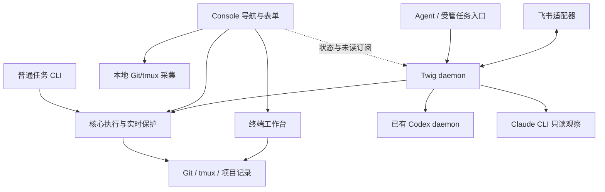

# Twig 当前架构与设计决策

本文维护当前已确认的产品边界、模块职责与关键设计理由。整理日期：2026-11-05。使用方式见 [README](README.md) 和 [用户手册](docs/index.md)，开发与验收约定见 [AGENTS](AGENTS.md)、[贡献指南](CONTRIBUTING.md) 和 [独立验收入口](examples/README.md)。

历史方案与交接已移至 [archive](archive/README.md)。历史测试结果只说明当时的提交和环境，不代表当前工作区已验证；候选功能不构成实施授权。

## 产品范围

Twig 用 Git Worktree 隔离并行开发任务，用 tmux 托管终端进程，用内置 Console 和工作台统一导航与操作。一个项目对应一个 tmux Session，一个任务拥有独立分支、Worktree 和任务窗口；主工作目录也可从 Console 进入。

核心能力是项目登记、普通任务生命周期与终端工作台。Agent 协作、受管 Codex 任务、持续状态采集和未读通知由可选 Twig 后台承载；飞书是可选通信通道。普通任务不依赖 Twig 后台、Codex 或 Codex Desktop。

Twig 不管理共享 Codex daemon 的启动、重启或停止。Git clone、remote、代码审查、合并、推送和 PR/MR 由用户或 Agent 使用相应工具完成。Worktree 不隔离端口、数据库、Git 共享配置、hooks 或外部缓存。

## 执行路径与进程边界

- 普通任务的 CLI、Console 表单始终在本地执行，使用调用进程环境。路径由操作类型及任务绑定决定，不随后台在线状态改变。
- Agent 命令、`new --agent` 和已有受管任务的 open/stop/rm 经 Twig 后台执行，使用后台启动环境；后台缺失或请求失败明确报错，不回退本地或重发。
- 本地与后台复用确认计划、业务实现、项目锁和资源保护，并以配置隔离的执行锁协调写操作。后台执行前再次核对任务绑定。
- 强制退出本地调用进程不保证操作继续完成；已启动的 tmux 进程独立存活。关闭 Console 不停止后台已接受的工作。

采用 Rust、一个 Cargo 包、同步外部命令和有界工作线程，不引入异步运行时。Git/tmux 参数逐个传递；失败保留上下文，不能以静默回退掩盖结果未知。

## 模块与事实来源

| 入口或模块 | 职责 |
| --- | --- |
| `src/main.rs`、`src/core.rs` | CLI 路由、执行路径选择、本地操作及共享业务保护 |
| `src/registry.rs`、`src/config.rs` | 项目登记、配置、资源身份与任务记录 |
| `src/git.rs`、`src/tmux.rs`、`src/startup.rs` | Git/tmux 查询与操作、窗口启动配置 |
| `src/console/` | 导航、表单、核心采集、后台订阅、选区与通知展示 |
| `src/workbench.rs`、`src/workbench/` | tmux Control Mode 工作台和 Pane 选区 |
| `src/daemon/` | 配置隔离的后台、操作调度、快照与详情查询 |
| `src/daemon/operations/store.rs` | 本地与后台共用的单操作记录存储 |
| `src/agent/` | 受管会话、消息队列、历史解析与主控界面 |
| `src/agent/stream.rs`、`src/daemon/feishu/`、`src/daemon/feishu.rs` | 持久化新消息事件与飞书接入、投递 |
| `src/codex.rs`、`src/claude.rs` | 与写操作分离的会话状态观察 |
| `src/clipboard.rs`、`src/mouse_selection.rs` | 顺序复制与共享连击、词边界规则 |
| `src/zed.rs` | 远程任务链接生成与配置校验 |
| `src/guide.rs`、`src/completion.rs`、`src/completion.zsh` | 离线手册与只读动态补全 |

Git 决定分支、文件和 Worktree 的真实状态；tmux 决定窗口、Pane 与进程状态；Codex 状态来自当前连接的服务，Claude 状态来自 CLI 采样。登记记录补充归属、绑定和创建意图，不能替代实时检查。窗口存在不代表 Agent 正在运行；本地 upstream 引用不代表远端实时状态。

## 配置、资源身份与存储

用户配置默认是 `~/.twig/config.toml`，所有入口遵循 `--config`。`[projects]` 保存别名与仓库路径，最近使用时间也由登记表保存；remote URL 以 Git 为准。登记更新保留启动和 Zed 配置。

项目配置、任务记录和项目锁位于登记表同目录的 `projects/<仓库 ID>/`。ID 来自规范化共享 Git 目录路径的稳定哈希：关联 Worktree 共用状态，不同本地克隆独立。相同目录的登记表共享项目状态，不同目录也不能隔离同一 Git/tmux 外部资源。不读取或迁移旧 `.git/twig/` 数据，不自动修复仓库搬迁。

任务启动配置优先读取主仓库 `.twig/config.toml` 的 `[tmux]`，否则使用用户配置，整体覆盖而不合并 Pane。仅创建任务窗口时执行，main 窗口不应用；部分失败保留资源，不能重复启动已执行命令。普通任务默认 Shell；shell/process 模式详见 [任务窗口](docs/windows.md)。

本地操作保存在配置旁 `operations/<配置身份>/operations/`，后台操作保存在 `daemon/<配置身份>/operations/`，`operation ls/show` 汇总两者。通知保存到配置旁 `notifications.json`；非 `config.toml` 的配置使用 `notifications/<配置路径哈希>.json`。主控与渠道状态不写入用户配置；完整位置见 [配置与存储](docs/configuration.md)。

## 生命周期与数据保护

### 创建与进入

`add` 初始化并登记已有仓库，同路径复用、别名冲突不覆盖。任务命令显式指定项目和任务，不按调用目录猜测。

`new` 拒绝已登记同名任务，包括部分失败和资源缺失的记录。已有任务通过 `open` 或 Console 进入；缺失 Worktree 先人工核对。未登记的同名本地或远端跟踪分支可经确认复用，本地优先；多 remote 需确定来源，远端来源建立本地分支及 upstream。确认默认取消，执行前复查分支快照和占用，非交互 CLI 拒绝这一交互复用流程。

新建分支默认 fetch base 的远端 upstream，从取得的远端提交创建；不更新本地 base 或主工作目录，也不包含本地 base 独有提交。缺少 upstream 或 fetch 失败时停止，不留下创建意图、分支或窗口。`--no-fetch` 使用本地 base；复用已有分支不 fetch。其他普通任务管理不隐式 Git 联网；用户启动程序的联网由程序自身决定。

`new` 默认创建后进入内置工作台；`--no-open` 仍创建 Pane 并运行启动命令。`open` 复用窗口，缺失时按配置重建。准备与执行复查固定项目配置、目标记录、目录设备/inode 和窗口身份，锁内继续检查目标分支与路径归属；文件变化、正常提交或其他任务变化不阻止进入。

Console 连接已有窗口不新增操作记录，不在复用流程里隐式重建；重建须走记录流程。普通 Open 非阻塞取执行锁，忙时提示。`Ctrl-W d` 返回 Console 并保留目标选择与任务进程，不切换外层 tmux 客户端。

### 停止与删除

普通 `stop` 经确认停止任务窗口内进程，保留 Worktree 和分支；受管任务还中断轮次并取消待发消息。`rm PROJECT` 只取消登记，`rm PROJECT TASK` 才删除任务资源。

CLI 删除默认保护未提交、未跟踪、ignored 文件、活动进程和未合并/未推送分支；`--keep-branch` 只跳过分支检查，`--delete-ignored` 只放行已核对的忽略文件。Console 删除默认取消，默认勾选删除分支和 ignored 文件；确认删除分支后使用 `git branch -D`，但仍保护工作文件、资源归属与活动进程。两种入口的差异必须在 [安全清理](docs/cleanup.md) 中明确展示。

确认前与执行前实时检查目标 Pane 的直接子进程：Linux 查询目标 PID 全部线程的 children，macOS 使用 libproc。查询失败或 PID 消失均拒绝删除，不扫描全机进程、不缓存空闲结论。删除按窗口、Worktree、分支、记录推进；部分失败保留资源和诊断，不为了回滚而删除用户工作。

### 操作记录与恢复

确认阶段不持执行锁；提交后持久化操作，执行前实时校验。后台取得执行锁后才标 running，并持锁至最终记录落盘。活跃后台 queued 不阻塞已持锁本地操作，锁释放后的遗留 running 仍须核对。

记录按 ID 独立写入，经缓冲、flush、sync_all 后原子替换。终态先保存到 `operations/archive/`，再移除活动记录；执行前只扫描活动目录，历史查询合并全部记录。旧 `operations.json` 只有完整迁移后才发布新目录，旧文件保留为备份，新目录启用后不再回读旧表。活动记录损坏阻止执行，归档损坏也须明确报告。

崩溃或最终保存失败保留待核对状态，不自动重跑。人工检查真实资源后通过 `operation resolve` 解除阻塞；解除不是成功重试或回滚。业务错误、捕获输出和存储失败须同时保留。

后台启动和离线维护由 maintenance.lock 与真实 instance.lock 协调。在线解除经 RPC；离线解除先检查并确认，再按 execution.lock → maintenance.lock 顺序取锁复查。只读探测不创建文件，使用非阻塞共享锁；不能确认离线时保留原状态，RPC 失败不回退离线写入。

## Console、工作台与后台查询

Console 核心采集和后台订阅分线程：本地提供登记、Git/tmux 和 Zed 配置，后台只补充 Agent 状态、详情与未读。后台故障不能阻塞核心导航。工作台期间暂停 Git 浏览采集，持续通知仍由后台处理。

项目与任务按最近成功创建或进入工作台的时间排序，主工作目录参与任务排序；仅浏览不更新。项目栏 Enter 清空任务筛选并选中当前排序第一项。全局监控独立于当前选择、搜索与历史筛选，不接受键盘焦点。

快照只保留最新完整版本；归属解析在 UI 读取锁外完成，按路径、会话或登记变化失效。Git 扫描中间发布间隔至少 100ms，首次列表和扫描结束立即发布。详情查询使用两个有界 worker，同客户端在途去重，慢详情不占用普通快照/未读 RPC 线程。

表单项目与分支校验使用可取消线程及 Git 2 秒查询限制；删除清单异步查询不限时，Esc 可取消并回收查询进程。写操作不得套用浏览超时或被强杀。Console 内核心执行捕获输出，不直接打印进度污染终端；CLI 显式选择终端输出。

工作台以 tmux capture-pane 为权威画面，不在前端维护第二套终端运行状态；特殊键和 bracketed paste 由 tmux 编码。Twig 定义工作台快捷键与外观，不加载 tmux 状态栏或键绑定。选区冻结起始 Pane 画面，后台进程继续；按住左键滚轮可延伸跨屏选区。复制、双击选词与三击选行共用规则和顺序剪贴板线程，OSC 52 由 UI 写出，不把终端请求当成已确认复制成功。

工作台复制从同次冻结快照的 `capture-pane -F -T -N` 读取 W 标记，合并终端自动折行，保留程序显式输出的硬换行。Agent 对话、工具与输入区在排版时保留正文范围、原文分隔与续行缩进，渲染和选区共用布局；Markdown 复制渲染正文，表格保留布局。Tab 的测量、显示和光标统一为一列空白，复制通过列映射还原 Tab，粘贴保留原始 Tab；行尾空白沿用排版规则。Console 导航和表单按显示行复制。

Zed 入口只生成 OSC 8 链接，由本机终端处理，不执行打开命令、不改变最近使用或未读；配置错误停用旧链接，重绘和弹窗遮挡必须清除旧目标。

## Agent、观察与通知

主控通过 Twig CLI 派活，规范集中在 [主控 skill](skills/twig-controller/SKILL.md)，由安装步骤复制到主控工作区，不在运行时写 skill。主控显式使用无需审批、完整访问权限，页面常驻红色 YOLO 提示；子任务沿用自己的 Codex 权限配置。

只有 `new --agent` 建立受管任务绑定和 `.twig/state.md`，不迁移普通任务。来源声明仅用于展示，不构成身份认证。消息先持久化后发送，结果未知用 clientUserMessageId 核对，不自动重发；旧绑定回调不能作用于同名重建任务。送达、一轮完成和任务验收是不同状态。

主控历史由可见租约控制的 worker 读取，无查看者时暂停；后台持续调度独立于 UI。完成补查读取不含 items 的轮次分页及持久化水位，网络查询不持 runtime 锁，提交前复查绑定和旧水位，未变化不写盘。完整历史解析集中于 `src/agent/history.rs`；Markdown 移植来源和许可见 [third_party/codex](third_party/codex/README.md)。

Codex 观察仅在明确 completed 及轮次 ID 上产生完成事件，首次发现建立基线，不把 idle、卸载或窗口存在当成完成。Agent 消息仅在 sent 后按消息 ID 去重提醒。Claude 仅通过 CLI 只读采样；连续已知状态中离开运行中或进入等待处理才提醒，首次发现、失联恢复、消失或过长采样间隔重新建基线。Claude 提醒尽力而为，不代表可靠轮次完成或验收通过。

事件先持久化再推进采集水位，未读与去重跨重启保留；卡片不重播。实际查看任务或主控时静默并清除已看到的事件，选中列表、打开未读列表或卡片到期均不清除。客户端按事件 ID 在文件锁内合并已读，离线也有效，不用旧缓存覆盖新事件。多窗口通过查看租约同步，后台实例变化触发完整快照；逐帧回调只读缓存，不同步轮询 RPC。

## 后台与飞书

每个 `--config` 有独立 Twig 后台，socket 位于固定 `/tmp/twig-UID/` 下，使用配置身份、单例锁及 0700/0600 权限保护。监听器可非阻塞，接入连接必须显式恢复阻塞读取并设置超时，兼顾 Linux 与 macOS/BSD 行为。

后台由用户显式启动；手动 restart 有序清理后 exec 新版，保留原环境，以新实例 ID 确认，不导出凭证或重发未知重启。前台及系统托管实例由原启动方式管理；安装失败不得重启，服务示例不自动安装。操作方式见 [后台指南](docs/daemon.md)。

飞书应用机器人仅接收允许 open_id 的单聊文本。接收先落盘再 ACK，按稳定平台消息 ID 去重，以持久化接收序号顺序入队；入队失败不让后续消息越过。

飞书仅消费持久化新消息事件：首次接入保存订阅位置，不读取旧会话或补发历史；随后同步通过 Twig 进入主控的新输入及对应最终回复。工具、中间进度、子任务回报正文和子任务内部会话不出站。最终回复绑定实际 turn，出站游标及分段原子保存；未知发送保留 sending 和诊断，不自动重发。旧 webhook 仅用于显式主动通知。配置与用户可见边界见 [飞书指南](docs/feishu.md)。

## 限制与未决事项

- 不支持裸仓库、非 UTF-8 路径或自动仓库搬迁修复。Squash/rebase 合并可能无法通过祖先关系检查，不能据此自动放宽删除保护。
- 多客户端沿用 tmux 的尺寸与窗口选择规则，不提供独立布局或通用 tmux 键绑定集成。
- 真实 SSH、真实模型/飞书、具体终端的 Zed 链接效果和高吞吐慢链路场景，不能由本地固定模型与 PTY 验收结果推定已覆盖。
- `doctor`、更详细的独立 `status`、直接使用远端分支作为 `--base` 等保留为讨论候选，没有实施优先级或授权。新增需求需重新确认语义；旧方案中的默认 fetch 和完成通知等已经实现，不再列为候选。

## 文档维护

用户行为在 `docs/` 对应主题维护，并通过 `src/guide.rs` 离线分发；README 保留入口。架构变化直接更新本文相关章节，开发安全与验收要求更新 AGENTS 和验收入口。不再向本文追加逐轮测试数量、安装状态或分支同步日志。

只有需要保留设计演变依据时才补充历史归档，注明日期、适用阶段和替代文档；历史不能覆盖本文，也不自动转为下一轮待办。当前代码、工作区及测试状态须在开始工作时重新核对。
