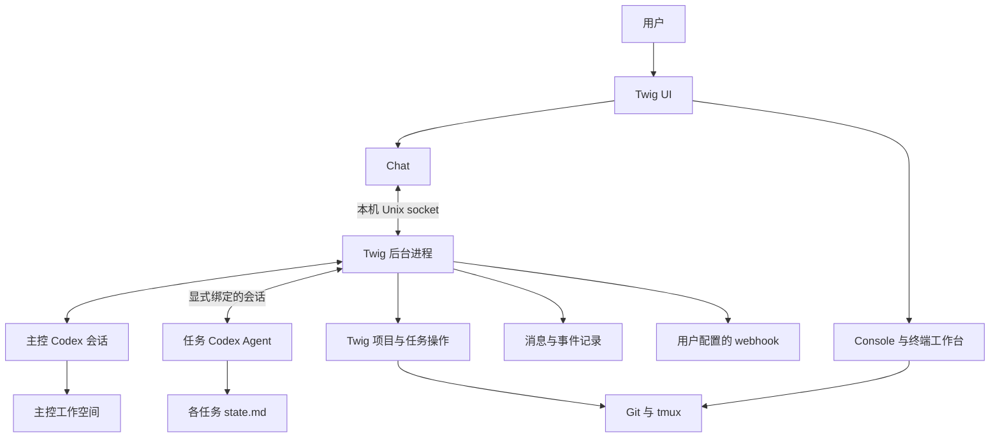

# RFC 主控 Agent 与全局 Chat

状态：草案，待评审。日期：2026-10-22。

Twig 拟新增全局 Chat 和可持续运行的主控 Agent。用户通过 Chat 交代目标，主控查看已登记项目、创建并派发任务、与任务 Codex 沟通、跟进结果，并在需要用户决策或重要目标完成时通过 webhook 通知用户。Console 继续提供项目导航、任务状态和终端工作台。

本文是方案讨论，不代表功能已经实现，也不自动授权实施所有建议。现有行为以 [README](README.md)、[DESIGN](DESIGN.md) 和 [开发约定](AGENTS.md) 为准。

## 需求与决策状态

### 已确认的需求

- 主控面向所有已登记项目与任务，具备派活和推进工作流的能力；观察、追问与执行之间主要通过权限控制。
- 主控能够与具体任务的 Codex Agent 对话。
- Chat 做在 Twig 内，与 Console 平级，可相互切换。
- 关闭界面后，主控可以继续工作。
- Webhook 用于主控有重要事项时通知用户，当前不要求从通知渠道回复或远程下达指令。
- 新任务拥有 `.twig/state.md`，主控通过它了解任务语义状态。
- 主控工作空间可以放在 `~/.twig` 下；模型接入考虑 API key 或 CLIProxy 反代。

### 本 RFC 提议

- 一个 Rust Cargo 包增加后台运行入口，通过本机 Unix socket 连接 Chat；不引入公网 HTTP 服务。
- 主控复用 Codex 运行时，不在 Twig 内重新实现通用模型工具循环。
- 每套配置维护一个逻辑主控；主控按用户输入和任务事件运行，无事件时等待。
- 任务消息采用显式会话绑定，忙时排队；第一版不自动打断正在运行的任务轮次。
- Markdown 保存目标、进展和交接信息；程序保存会话绑定、消息投递和事件处理记录。
- 首次进入 Chat 启动后台，退出 UI 不停止后台；提供显式状态与停止操作，第一版不做开机自启。

启动行为、权限细节、模型配置方式及以下未决项仍需评审确认。

## 背景与现有基础

Twig 当前负责 Git Worktree、分支和 tmux 任务环境。`src/config.rs` 的任务记录保存分支、起点和路径，不保存开发目标或 Agent 会话绑定。`src/codex.rs` 通过已有本机 Codex 服务查询会话和轮次；该客户端是只读观察者，忽略通知与审批请求，不负责恢复会话或发起工作。

Console 已经具备跨项目监控和轮次完成通知。完成通知只保存在当前进程，首次观察建立基线，不能直接作为持久化工作流事件系统。任务环境存在、会话空闲、轮次完成和开发任务完成是不同事实。

本提案有意识地扩展现有“不编排 Agent、无后台服务”的边界。扩展只发生在显式启用主控的路径；普通浏览、Shell 任务和 Git 生命周期操作仍应独立可用，不要求模型认证或后台服务在线。

## 目标与第一版范围

第一版形成完整闭环：用户交代一个目标，主控创建或选择任务、发送要求、等待反馈、检查进展、继续跟进或请求用户决策。用户可以随时切换到 Console 查看现场。

包括全局 Chat、后台生命周期、一个主控 Codex 会话、任务会话绑定与通信、任务状态模板、事件唤醒、重要事项 webhook，以及重连恢复所需的持久记录。

第一版不包括多层主控树、通用工作流 DSL、自动合并部署、跨机器任务执行、通知渠道双向聊天、公共远程控制 API、服务商适配平台和开机自启。API key 与 CLIProxy 是待确定的接入选项，不承诺第一版同时支持所有接口变体。

## 用户体验

### Chat 与 Console

Chat 是全局会话，切换 Console 中的项目不会隐式切换主控上下文。用户可在消息中指明项目，主控也可主动跨项目查询。具体切换快捷键在 UI 实施时确定，避免与工作台的 Ctrl-W 前缀冲突。

Chat 展示用户消息、主控回复及必要的工作流动作：任务创建、消息排队、发送结果、任务反馈、待决策事项和通知投递状态。工具执行细节按需展开，不把全部内部协议打印成聊天内容。任务条目可以跳转 Console 中对应任务。

主控派发任务后可以结束当前回复并等待事件，界面显示“等待任务反馈”；用户仍可发送新要求。多条输入进入同一个有序的主控会话，不能并发修改同一会话上下文。重新打开 Chat 从持久化记录恢复，流式显示属于展示层，不是唯一历史来源。

### 典型工作流

1. 用户：“给项目 A 修复登录失败的问题，完成测试后告诉我。”
2. 主控确认目标与验收条件；信息足够时创建任务、绑定 Codex 会话并派发。
3. 任务 Agent 执行并维护自己的 `.twig/state.md`；主控等待期间可处理其他事项。
4. 任务轮次结束，后台记录事件并唤醒主控。主控读取反馈和状态，判断是否需要补充验证、继续执行或询问用户。
5. 缺少关键需求时，主控在 Chat 留下问题并通过 webhook 提醒；问题未答复前不自行假定答案。
6. 达到约定验收条件后，主控报告完成及验证依据。是否提交、推送或创建 PR 取决于本次授权。

“轮次完成”只触发检查；完成判定必须联系任务目标、验证结果和仍未解决的问题。

## 系统架构



### Twig 后台

后台负责接收 UI 消息、调度主控、维护任务绑定、收集事件、投递任务消息和 webhook。它是本机常驻进程，不要求 HTTP 监听端口。外发 webhook 不需要公网入站连接。

后台和 UI 生命周期分离。关闭 UI 或 SSH 连接不应终止后台；这要求实现真正的进程脱离与标准输入输出管理，不能仅依靠 UI 的子线程。主机关机、用户会话清理策略或进程崩溃仍可能停止后台，第一版不承诺系统级保活。

每套配置只允许一个后台写入运行记录，启动竞争由单实例机制处理。socket 路径和连接端身份必须关联配置身份；残留 socket 不能仅凭文件存在就判断服务健康。IPC 仅供当前用户访问。

保持单 Cargo 包与现有同步命令风格。用必要的工作线程隔离 UI、Codex 通信和网络投递；不因新增主控默认引入异步运行时。阻塞的模型请求或 webhook 不能阻止状态查询、停止和其他任务事件入队。

### Codex 运行时

主控逻辑优先作为 Codex 会话运行，Twig 提供有限的工作流工具。Codex 负责模型推理、上下文和实际工具循环，Twig 不重复构建另一套通用 Agent 框架。

官方 [App Server 文档](https://learn.chatgpt.com/docs/app-server) 提供会话、轮次以及 `turn/start`、`turn/steer` 等交互接口，作为通信候选。接口存在不能证明本机任意 CLI 会话都能被外部客户端可靠控制；须通过安装版本的隔离实验确认服务发现、会话加载、审批、事件及终端同步行为。

连接现有服务还是启动主控专用实例，是技术验证后的决策。专用实例便于隔离主控生命周期；连接已有服务可减少进程，但必须明确会话与审批归属。任务会话所在服务可能与主控不同，因此不能只保存一个全局服务地址。

Twig 工具通过 Codex 支持的工具扩展方式暴露；具体采用 MCP 或该版本支持的其他机制待验证。不能以“有 shell 权限即可调用任意命令”代替可执行的权限边界。

## 数据与工作目录

默认布局建议如下，文件名和存储格式在实现时收敛：

```text
~/.twig/
├── config.toml
├── projects/                     # 现有项目与任务登记
└── controller/
    ├── workspace/
    │   ├── AGENTS.md              # 主控职责与工作规则
    │   └── state.md               # 全局计划与待跟进事项
    └── runtime/                  # 会话绑定、消息、事件、通知记录
```

主控 cwd 指向 `controller/workspace`，不直接设为整个配置目录。cwd 只是工作位置，不是访问控制；凭据和运行记录仍需要独立权限与工具限制。

`--config` 必须贯穿 UI、后台及其调用的 Twig 命令，不能回退到真实默认配置。默认数据位于配置文件同目录；若同一目录允许多个配置文件，后台实例、socket 和主控数据还须按配置文件规范路径区分，避免串用。具体命名方式在实施前定下。

| 数据 | 写入者 | 用途 |
| --- | --- | --- |
| 项目与任务登记 | Twig 生命周期操作 | 资源归属与创建意图 |
| Git、tmux、Codex 实时状态 | 对应系统 | 当前运行事实 |
| 任务 `.twig/state.md` | 任务 Agent，用户可人工修正 | 目标、进展、阻塞与验证 |
| 主控 `workspace/state.md` | 主控 Agent | 全局计划、依赖与跟进 |
| 会话绑定与消息记录 | Twig 后台 | 精确投递、恢复与审计 |

不让 Markdown 承担锁、消息队列或会话 ID 数据库的职责。第一版可用原子替换的结构化文件与追加日志实现持久化；若恢复与一致性要求使文件协议明显复杂，再评估 SQLite，不预先引入存储抽象层。

## 任务 state.md

新任务在 Worktree 创建成功后、启动任务程序之前初始化 `.twig/state.md`。建议写入模板而非空文件：

```markdown
# 任务状态

## 目标与验收标准
待补充

## 当前进展
尚未开始

## 阻塞与待决策
无

## 下一步
明确需求

## 验证结果
尚未验证
```

主控派发时提供目标和要求；任务 Agent 负责在阶段完成、阻塞及交接时更新。主控默认只读，需要补充时向任务 Agent 发消息。启动上下文必须明确维护规则，不能假设文件存在就会自动被遵守，也不应自动改写用户仓库的 AGENTS.md。

状态陈旧、缺失或与最新反馈矛盾时，展示不确定性并追问，不能据此宣布任务完成。更新频率不要求逐条工具调用写入。状态更新与轮次结束可能不同步，主控须结合当前反馈读取。

建议将文件作为本地运行状态，不随代码提交；具体使用何种 Git 忽略机制待确认。不得忽略整个 `.twig/`，其中可能已有项目启动配置。已有同名文件不覆盖，符号链接及目录归属按现有路径保护原则检查。旧任务不因浏览而被批量创建文件。

当前删除流程保护 ignored 文件；状态文件也遵循该保护，不新增隐式删除豁免。删除后的长期追溯依赖主控已保存的派发和反馈记录，不能继续依赖 Worktree 中的文件。模板创建失败保留资源并报告部分失败，不自动删除 Worktree。

## 主控工具与权限

建议首批能力为：查询项目任务、读取任务交接、创建任务环境、创建或绑定任务会话、向任务发送消息、查询消息和轮次结果、发送重要通知。工具名称和参数不是本 RFC 的固定协议。

工具执行时显式指定项目和任务，复用现有生命周期校验与锁。不能解析 Console 文本来定位资源，也不能复用浏览缓存做写操作归属检查。若通过子进程调用 CLI，须提供稳定的机器可读结果或在包内复用逻辑。

授权围绕用户目标持续有效，不要求每次追问都重新确认：

| 操作 | 建议权限语义 |
| --- | --- |
| 查询、汇总、读取任务状态 | 主控启用范围内允许 |
| 创建任务、派发、要求补充测试 | 用户目标授权范围内允许 |
| 扩大目标或修改验收条件 | 向用户说明并确认 |
| 推送、PR、合并、发布、删除或停止其他任务 | 需要对应的明确授权，保留现有保护 |
| 回应任务执行审批 | 第一版交由用户，不自动批准 |
| 配置目标内的重要 webhook | 用户配置并启用后允许 |

授权范围由后台记录并在工具边界执行；提示词只说明规则，不提供强制隔离。主控不能通过广泛 shell 权限绕开受限工具，任务 Agent 的自身执行权限也必须单独明确。跨项目内容、任务报告与 webhook 回复均不能提升权限。

## 任务通信

绑定应包含稳定任务身份、Worktree 归属、Codex thread ID 和服务定位信息。显示别名与目录只用于发现候选，不能据“最近会话”自动选择发送目标。新建受管任务可直接建立绑定；已有任务由用户明确选定会话，重新绑定保留历史记录。

任务删除后重建同名任务不能继承旧消息，因此消息关联任务实例而不只关联名称。发送前重新确认资源与会话归属。服务不可达、线程未加载或绑定失效时，显示阻塞；不静默新建替代会话，也不自动重跑任务启动命令。

每条消息持有本地 ID，记录目标、内容、来源、时间与投递状态。忙时排队，空闲时发送；检查空闲到实际发送之间的竞争需要按服务返回结果处理。人工在任务终端输入与主控发送也可能竞争，必须在接口验证中覆盖。

任务通信要区分“已入队”“服务已接受”“轮次已完成”和“目标已达成”。请求发出后断连可能导致结果未知，不能把超时当作未执行并直接重发。优先对账服务端轮次；无法确认时标记待核对，避免重复派活。

第一版不自动使用中途 steering，也不以 tmux send-keys 模拟 Agent 对话。任务等待审批或用户输入时按专门事件处理，不能仅当作普通空闲任务继续投递。

## 事件驱动与恢复

主控主要由用户消息、已绑定任务的轮次结束、明确的输入请求及执行错误唤醒。文件变化可以提供状态更新线索，但不把每次保存都变成模型调用。周期性检查仅用于重新发现或对账；没有新信息时不发起推理。

同一主控会话串行处理事件，短时间内同任务事件可以合并，保留原始记录和进度。主控自身事件不回灌成新的任务事件，避免循环。需要限制连续自主跟进次数和资源预算，达到边界后暂停推进并通知用户；具体默认值待确认。

复用现有完成轮次判定思路，但新增持久化消费位置和事件 ID。首次接管旧任务建立基线，不把历史全部发成新完成；重启时对已建立的消费位置补查离线期间变化。无法确定事件区间时明确显示缺口。

后台保存输入、派发、工具执行结果和待投递通知。重启先恢复记录，再核对 Codex 线程和在途操作，随后继续可确认的工作。跨 Git、tmux、Codex 和 HTTP 没有统一事务，不承诺端到端恰好一次执行。创建部分成功沿用 Twig 的保留现场原则。

## Webhook

Webhook 是主控工具，面向用户预先配置的目标。主控选择重要性并撰写摘要，程序完成 HTTP 投递、超时、有限重试与结果记录。默认不发送完整代码、凭据或全部对话。

建议通知包括事件 ID、项目任务、摘要、需要用户采取的动作和本地任务标识。第一版没有远程控制入口，不承诺手机端可点击后直接打开本机 Twig。

需要用户决策、持续阻塞和重要目标完成适合通知；普通轮次结束保留在 Chat。记录通知与对应事项的关联，避免主控反复提醒同一个问题。

HTTP 请求可能已被接收但响应丢失，重试可能产生重复通知；使用稳定事件 ID，在接收端支持时去重。永久失败或重试耗尽显示在 Chat 和后台状态，不能向主控返回“通知成功”。目标 URL 和凭据不放入任务 Markdown 或普通日志。

## 模型接入

主控优先复用 Codex 的模型提供方配置，Twig 不同时维护一套功能重叠的模型客户端。需要定义主控与任务是否共享提供方配置，以及独立配置的作用域。

API key 与 CLIProxy 是接入选项；CLIProxy 的具体实现、协议和版本尚未确定。实施前验证所需请求协议、流式输出、工具调用、错误传播与认证方式，不能把普通文本请求成功当作完整兼容。

凭据沿用运行时支持的安全配置方式，不进入 Chat 历史、state.md 或仓库。模型不可用时 Chat 明确显示失败，Console 与普通任务管理继续可用。

## 与现有功能的集成

- Console 保留原有独立运行能力。主控服务存在时，避免为同一轮次重复维护彼此矛盾的工作流状态；现有 UI 完成卡片与主控重要通知保持语义区分。
- 普通 `new` 仍默认 Shell，新增状态文件不隐式把所有任务变成 Codex 任务。主控创建受管任务时才显式创建或绑定 Agent。
- 受管任务的程序启动与 `[tmux]` 配置必须统一：不能先运行用户配置的 Codex，再额外启动第二个 Agent。具体受管启动入口需在原型阶段验证。
- 停止后台不隐式关闭现有任务 tmux 窗口；主控在途轮次是停止、等待还是保留，停止命令必须清晰展示并定义行为。
- `rm`、项目取消登记和外部 Worktree 删除都需要使相关派发停止；保留历史，不将待发送消息投给同名新任务。
- 主控功能实施时同步更新 README、DESIGN、AGENTS 和对应 guide/帮助。此次仅新增 RFC，不提前把建议写成已实现的用户行为。

## 实施顺序与验收

### 阶段一 接口验证

在临时仓库、隔离 Codex 环境和独立 tmux socket 中验证：创建主控会话、暴露一个受限工具、绑定任务、发送消息、观察反馈、忙时排队、人工与主控交互、审批和断连恢复。确认任务终端能否一致展示外部发送的消息，以及所需的 Codex 实例归属。

阶段产出是明确的支持版本和接入方式；若接口不能支持，不直接以终端模拟输入替代，而是重新评审任务启动与显示方案。

### 阶段二 Chat 与后台

实现本机 IPC、单实例、原生 Chat、主控工作目录和最小持久化。验收 UI 切换保留选择、输入响应、关闭 UI 后后台存活、重新连接恢复历史、多个客户端消息顺序以及配置隔离。

### 阶段三 派发与跟进

接入状态模板、任务创建、会话绑定、消息队列和事件唤醒。覆盖部分创建失败、旧任务绑定、错误归属、消息结果未知、任务同名重建、主控重启和权限拒绝。主控必须完成一次“派发—反馈—补充验证—报告”的闭环。

### 阶段四 通知与完整验证

使用本地模拟 HTTP 接收端验证 webhook 成功、超时、失败重试、重复事件和重启恢复，不向真实用户发送测试消息。Codex 自动化使用模拟服务，真实协议实验只使用显式隔离会话，禁止向真实开发 Agent 发送输入。

代码实施完成后按开发约定执行 fmt、Clippy、Rust 测试，以及适用的 Console 和 Control Mode PTY 验收。纯 RFC 文档更新只检查一致性和链接。

## 待评审事项

1. 是否接受首进 Chat 启动后台、退出 UI 保留运行、第一版不做系统级自启的行为？
2. 主控使用独立 Codex 实例还是现有服务？受管任务如何启动、如何与用户现有 tmux 启动配置共存？由接口验证给出结论。
3. 主控工具以何种接口暴露，如何限制通用 shell 绕开授权？第一版默认允许的操作范围是什么？
4. `.twig/state.md` 的本地忽略机制，以及已有文件和旧任务的启用方式是否接受上述原则？
5. CLIProxy 指哪一个实现及部署方式？主控是否需要独立于任务的模型配置？
6. Webhook 第一版面向通用 JSON 接收端，还是指定某个通知平台？请求正文和认证方式随之确定。
7. 自主跟进预算、暂停与恢复的用户操作，以及显式停止后台时在途主控轮次的处理方式是什么？

上述问题不影响已确认的产品方向，但需要在对应功能编码前落实，避免把原型中的假设固化成行为。
