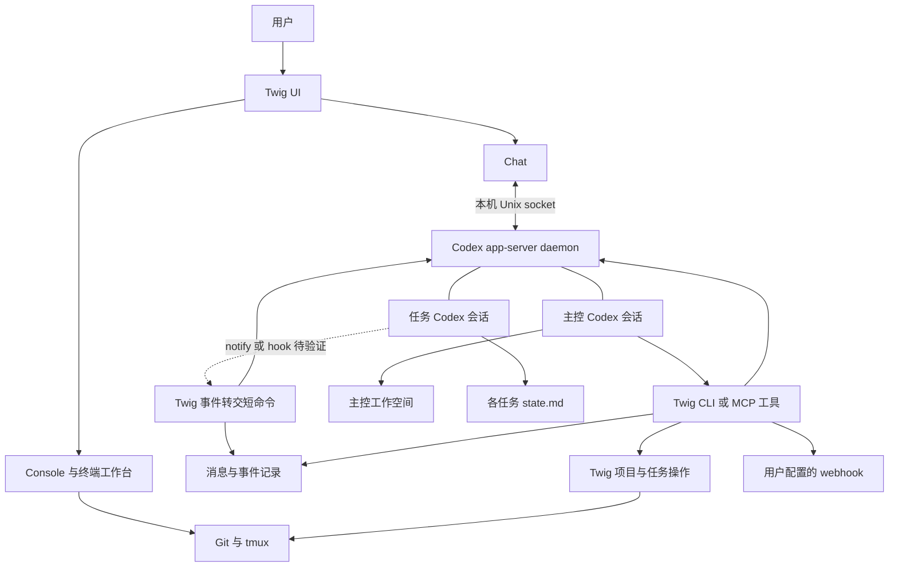

# RFC 主控 Agent 与全局 Chat

状态：草案，待评审。日期：2026-10-22。

Twig 拟新增全局 Chat 和可持续运行的主控 Agent。用户通过 Chat 交代目标，主控查看已登记项目、创建并派发任务、与任务 Codex 沟通、跟进结果，并在需要用户决策或重要目标完成时通过 webhook 通知用户。Console 继续提供项目导航、任务状态和终端工作台。

本文是方案讨论，不代表功能已经实现，也不自动授权实施所有建议。现有行为以 [README](README.md)、[DESIGN](DESIGN.md) 和 [开发约定](AGENTS.md) 为准。

## 需求与决策状态

### 已确认的需求

- 主控面向所有已登记项目与任务，具备派活和推进工作流的能力；观察、追问与执行之间主要通过权限控制。
- 主控能够与具体任务的 Codex Agent 对话。
- Chat 做在 Twig 内，与 Console 平级，可相互切换。
- 关闭界面后，主控可以继续工作。
- Webhook 用于主控有重要事项时通知用户，当前不要求从通知渠道回复或远程下达指令。
- 新任务拥有 `.twig/state.md`，主控通过它了解任务语义状态。
- 主控工作空间可以放在 `~/.twig` 下。
- 主控与任务均使用 Codex，通过 Codex 会话接口通信。Twig 不单独设计 API key 或 CLIProxy 反代接入，认证与模型配置沿用 Codex。
- 优先复用 Codex app-server daemon 承担常驻运行，Chat 直接作为客户端；不将独立 Twig server 作为实现前提。

### 本 RFC 提议

- 保持一个 Rust Cargo 包，增加原生 Chat 和工作流工具，通过本机 Unix socket 连接 Codex app-server，不新增 Twig 常驻服务或公网 HTTP 服务。
- 每套配置维护一个逻辑主控；主控按用户输入和任务事件运行，无事件时等待。
- 任务消息采用显式会话绑定，忙时排队；第一版不自动打断正在运行的任务轮次。
- Markdown 保存目标、进展和交接信息；程序保存会话绑定、消息投递和事件处理记录。
- 任务完成后由 Codex notify/hook 调用 Twig 短命令，记录事件并向主控投递；此路径须先验证，不能当作已具备的可靠事件系统。
- 退出 UI 只断开客户端，不主动停止共享 Codex daemon。daemon 不可用时的启动行为另行确定，不新增 Twig 开机自启机制。

daemon 启动行为、事件转交、工具执行方式和权限细节仍需验证或评审确认。

## 背景与现有基础

Twig 当前负责 Git Worktree、分支和 tmux 任务环境。`src/config.rs` 的任务记录保存分支、起点和路径，不保存开发目标或 Agent 会话绑定。`src/codex.rs` 通过已有本机 Codex 服务查询会话和轮次；该客户端是只读观察者，忽略通知与审批请求，不负责恢复会话或发起工作。

Console 已经具备跨项目监控和轮次完成通知。完成通知只保存在当前进程，首次观察建立基线，不能直接作为持久化工作流事件系统。任务环境存在、会话空闲、轮次完成和开发任务完成是不同事实。

2026-10-22 本机只读检查确认 CLI 与正在运行的 app-server daemon 均为 0.163.0；现有 Twig 已通过 `daemon version` 发现其 Unix socket。这是本机调查结果，不是跨版本兼容性承诺，也尚未完成退出 UI 后的端到端实验。

本提案扩展现有“不编排 Agent”的边界，但优先沿用 Codex 的后台运行能力。扩展只发生在显式启用主控的路径；普通浏览、Shell 任务和 Git 生命周期操作仍应独立可用，不要求模型认证或 Codex 服务在线。

## 目标与第一版范围

第一版形成完整闭环：用户交代一个目标，主控创建或选择任务、发送要求、等待反馈、检查进展、继续跟进或请求用户决策。用户可以随时切换到 Console 查看现场。

包括全局 Chat、Codex 服务连接与会话恢复、一个主控 Codex 会话、任务会话绑定与通信、任务状态模板、事件唤醒、重要事项 webhook，以及重连恢复所需的持久记录。

第一版不包括多层主控树、通用工作流 DSL、自动合并部署、跨机器任务执行、通知渠道双向聊天、公共远程控制 API、服务商适配平台和开机自启。不另建模型 API 客户端，也不设计反代接入功能。

## 用户体验

### Chat 与 Console

Chat 是全局会话，切换 Console 中的项目不会隐式切换主控上下文。用户可在消息中指明项目，主控也可主动跨项目查询。具体切换快捷键在 UI 实施时确定，避免与工作台的 Ctrl-W 前缀冲突。

Chat 展示用户消息、主控回复及必要的工作流动作：任务创建、消息排队、发送结果、任务反馈、待决策事项和通知投递状态。工具执行细节按需展开，不把全部内部协议打印成聊天内容。任务条目可以跳转 Console 中对应任务。

主控派发任务后可以结束当前回复并等待事件，界面显示“等待任务反馈”；用户仍可发送新要求。多条输入进入同一个有序的主控会话，不能并发修改同一会话上下文。重新打开 Chat 从持久化记录恢复，流式显示属于展示层，不是唯一历史来源。

### 典型工作流

1. 用户：“给项目 A 修复登录失败的问题，完成测试后告诉我。”
2. 主控确认目标与验收条件；信息足够时创建任务、绑定 Codex 会话并派发。
3. 任务 Agent 执行并维护自己的 `.twig/state.md`；主控等待期间可处理其他事项。
4. 任务轮次结束，Codex 回调触发 Twig 事件转交命令，记录事件并向主控投递。主控读取反馈和状态，判断是否需要补充验证、继续执行或询问用户；此链路须通过第一阶段实验。
5. 缺少关键需求时，主控在 Chat 留下问题并通过 webhook 提醒；问题未答复前不自行假定答案。
6. 达到约定验收条件后，主控报告完成及验证依据。是否提交、推送或创建 PR 取决于本次授权。

“轮次完成”只触发检查；完成判定必须联系任务目标、验证结果和仍未解决的问题。

## 系统架构



### 直接连接 Codex daemon

Chat 通过 Codex 自有协议创建或恢复主控会话、发送用户消息和展示事件。会话执行与持久化交给 Codex；Twig 保存项目任务绑定和必要的工作流记录，不另建聊天代理、daemon 生命周期管理器或完整对话存储。

UI 退出不调用共享 daemon 的停止命令，也不主动中断主控或任务轮次。再次打开时按已保存的 thread ID 读取或恢复主控。Codex 服务本身的安装、系统级保活和升级沿用 Codex 能力；Twig 不因某个会话错误重启整个共享服务。

官方文档描述最后一个订阅者取消订阅后，线程在无订阅且无活动 30 分钟后可被卸载；持久化会话仍可恢复。这不能直接证明任意断连场景下的工具、审批和任务回调都正常，必须单独验证。参见 [App Server 线程生命周期](https://learn.chatgpt.com/docs/app-server#unsubscribe-from-a-loaded-thread)。

Twig 的短命令负责派发、事件转交和通知投递，运行期间使用锁协调记录，不依赖单个后台写入者。保留同步外部命令风格，UI 通信使用必要线程保持响应，不预先引入异步运行时。只有隔离实验确认存在无法由现有机制解决的持续运行需求后，才评审最小后台组件。

### Codex 运行时

主控逻辑作为 Codex 会话运行，Twig 提供有限的工作流工具，并通过 Codex 会话接口与任务 session 通信。Codex 负责模型推理、上下文和实际工具循环，Twig 不重复构建另一套通用 Agent 框架。

官方 [App Server 文档](https://learn.chatgpt.com/docs/app-server) 提供会话、轮次以及 `turn/start`、`turn/steer` 等交互接口，作为通信候选。接口存在不能证明本机任意 CLI 会话都能被外部客户端可靠控制；须通过安装版本的隔离实验确认服务发现、会话加载、审批、事件及终端同步行为。

默认连接已有 daemon，在其中创建独立主控 session。须明确会话与审批归属；任务会话所在服务可能与主控不同，因此绑定仍记录服务定位信息。只有实际隔离需求或接口限制要求时才考虑专用 Codex 实例，不预先增加实例。

Twig 工具优先通过 Codex 可独立调用的 CLI 或由 Codex 管理连接的 MCP 暴露，退出 UI 后仍须可用。App Server 的 `dynamicTools` 会将执行请求交给连接客户端，因此不能把必须持续可用的工具只实现在 Chat 进程中。MCP 的进程与连接生命周期仍需验证。不能以“有 shell 权限即可调用任意命令”代替可执行的权限边界。

## 数据与工作目录

默认布局建议如下，文件名和存储格式在实现时收敛：

```text
~/.twig/
├── config.toml
├── projects/                     # 现有项目与任务登记
└── controller/
    ├── workspace/
    │   ├── AGENTS.md              # 主控职责与工作规则
    │   └── state.md               # 全局计划与待跟进事项
    └── runtime/                  # 会话绑定、消息、事件、通知记录
```

主控 cwd 指向 `controller/workspace`，不直接设为整个配置目录。cwd 只是工作位置，不是访问控制；凭据和运行记录仍需要独立权限与工具限制。

`--config` 必须贯穿 UI、主控工具和事件转交命令，不能回退到真实默认配置。默认数据位于配置文件同目录；若同一目录允许多个配置文件，主控绑定和数据还须按配置文件规范路径区分，避免串用。不同配置可以连接同一个 Codex daemon，但不能混用主控 thread ID、授权或消息记录。具体命名方式在实施前定下。

| 数据 | 写入者 | 用途 |
| --- | --- | --- |
| 项目与任务登记 | Twig 生命周期操作 | 资源归属与创建意图 |
| Git、tmux、Codex 实时状态 | 对应系统 | 当前运行事实 |
| 任务 `.twig/state.md` | 任务 Agent，用户可人工修正 | 目标、进展、阻塞与验证 |
| 主控 `workspace/state.md` | 主控 Agent | 全局计划、依赖与跟进 |
| 对话与轮次历史 | Codex | Chat 重连与上下文恢复 |
| 会话绑定与消息记录 | Twig 工具及事件转交命令 | 精确投递、恢复与审计 |

不让 Markdown 承担锁、消息队列或会话 ID 数据库的职责。第一版可用原子替换的结构化文件与追加日志实现持久化；若恢复与一致性要求使文件协议明显复杂，再评估 SQLite，不预先引入存储抽象层。

## 任务 state.md

新任务在 Worktree 创建成功后、启动任务程序之前初始化 `.twig/state.md`。建议写入模板而非空文件：

```markdown
# 任务状态

## 目标与验收标准
待补充

## 当前进展
尚未开始

## 阻塞与待决策
无

## 下一步
明确需求

## 验证结果
尚未验证
```

主控派发时提供目标和要求；任务 Agent 负责在阶段完成、阻塞及交接时更新。主控默认只读，需要补充时向任务 Agent 发消息。启动上下文必须明确维护规则，不能假设文件存在就会自动被遵守，也不应自动改写用户仓库的 AGENTS.md。

状态陈旧、缺失或与最新反馈矛盾时，展示不确定性并追问，不能据此宣布任务完成。更新频率不要求逐条工具调用写入。状态更新与轮次结束可能不同步，主控须结合当前反馈读取。

建议将文件作为本地运行状态，不随代码提交；具体使用何种 Git 忽略机制待确认。不得忽略整个 `.twig/`，其中可能已有项目启动配置。已有同名文件不覆盖，符号链接及目录归属按现有路径保护原则检查。旧任务不因浏览而被批量创建文件。

当前删除流程保护 ignored 文件；状态文件也遵循该保护，不新增隐式删除豁免。删除后的长期追溯依赖主控已保存的派发和反馈记录，不能继续依赖 Worktree 中的文件。模板创建失败保留资源并报告部分失败，不自动删除 Worktree。

## 主控工具与权限

建议首批能力为：查询项目任务、读取任务交接、创建任务环境、创建或绑定任务会话、向任务发送消息、查询消息和轮次结果、发送重要通知。工具名称和参数不是本 RFC 的固定协议。

工具执行时显式指定项目和任务，复用现有生命周期校验与锁。不能解析 Console 文本来定位资源，也不能复用浏览缓存做写操作归属检查。若通过子进程调用 CLI，须提供稳定的机器可读结果或在包内复用逻辑。

授权围绕用户目标持续有效，不要求每次追问都重新确认：

| 操作 | 建议权限语义 |
| --- | --- |
| 查询、汇总、读取任务状态 | 主控启用范围内允许 |
| 创建任务、派发、要求补充测试 | 用户目标授权范围内允许 |
| 扩大目标或修改验收条件 | 向用户说明并确认 |
| 推送、PR、合并、发布、删除或停止其他任务 | 需要对应的明确授权，保留现有保护 |
| 回应任务执行审批 | 第一版交由用户，不自动批准 |
| 配置目标内的重要 webhook | 用户配置并启用后允许 |

授权范围持久化并由 Twig 工具在执行边界检查；提示词只说明规则，不提供强制隔离。主控不能通过广泛 shell 权限绕开受限工具，任务 Agent 的自身执行权限也必须单独明确。跨项目内容、任务报告与 webhook 回复均不能提升权限。

## 任务通信

绑定应包含稳定任务身份、Worktree 归属、Codex thread ID 和服务定位信息。显示别名与目录只用于发现候选，不能据“最近会话”自动选择发送目标。新建受管任务可直接建立绑定；已有任务由用户明确选定会话，重新绑定保留历史记录。

任务删除后重建同名任务不能继承旧消息，因此消息关联任务实例而不只关联名称。发送前重新确认资源与会话归属。线程未加载时可按绑定恢复原会话；服务不可达、恢复失败或绑定失效时显示阻塞，不静默新建替代会话，也不自动重跑任务启动命令。

每条消息持有本地 ID，记录目标、内容、来源、时间与投递状态。忙时排队，空闲时发送；检查空闲到实际发送之间的竞争需要按服务返回结果处理。人工在任务终端输入与主控发送也可能竞争，必须在接口验证中覆盖。

排队不能只实现为写文件。须验证 Codex 是否提供适用的队列语义，或由轮次结束回调触发出队；UI 退出、主控忙碌和回调失败时也要有明确消费路径。在此之前不承诺无客户端连接时消息必然自动送达。

任务通信要区分“已入队”“服务已接受”“轮次已完成”和“目标已达成”。请求发出后断连可能导致结果未知，不能把超时当作未执行并直接重发。优先对账服务端轮次；无法确认时标记待核对，避免重复派活。

第一版不自动使用中途 steering，也不以 tmux send-keys 模拟 Agent 对话。任务等待审批或用户输入时按专门事件处理，不能仅当作普通空闲任务继续投递。

## 事件驱动与恢复

主控主要由用户消息、已绑定任务的轮次结束、明确的输入请求及执行错误唤醒。文件变化可以提供状态更新线索，但不把每次保存都变成模型调用。周期性检查仅用于重新发现或对账；没有新信息时不发起推理。

候选路径是 Codex `notify` 或 hook 调用 Twig 短命令：校验任务绑定，保存事件，再向主控投递。官方 `notify` 支持 `agent-turn-complete`，携带 thread ID、turn ID 和 cwd；[Hooks](https://learn.chatgpt.com/docs/hooks) 也提供 Stop 等生命周期事件。参见 [通知配置](https://learn.chatgpt.com/docs/config-file/config-advanced#notifications)。这些接口不是现成的跨会话调度器，须验证 daemon 模式下无 UI 时的执行、配置作用域与回调失败处理。

完成通知不能覆盖所有错误和审批事件。需要确认对应 hook 或其他运行时事件是否可用；不能覆盖的事件在 Chat 重连时对账并展示，若要求离线即时提醒则另行补足触发路径。第一版不以模型持续轮询充当事件监听器，也不默认增加常驻轮询进程。

同一主控会话串行处理事件，短时间内同任务事件可以合并，保留原始记录和进度。主控自身事件不回灌成新的任务事件，避免循环。需要限制连续自主跟进次数和资源预算，达到边界后暂停推进并通知用户；具体默认值待确认。

复用现有完成轮次判定思路，但新增持久化消费位置和事件 ID。首次接管旧任务建立基线，不把历史全部发成新完成；Chat 重连或事件转交命令运行时，对已建立的消费位置补查离线期间变化。无法确定事件区间时明确显示缺口。Codex 重启后若没有客户端或新回调触发恢复，不承诺仅凭记录自动恢复工作流。

Codex 保存会话输入和历史，Twig 保存派发关联、工具执行结果和待投递通知。恢复时先核对 Codex 线程和在途操作，再继续可确认的工作。短命令失败后的记录由后续回调或显式恢复操作处理；没有触发源时不会自动重试。跨 Git、tmux、Codex 和 HTTP 没有统一事务，不承诺端到端恰好一次执行。创建部分成功沿用 Twig 的保留现场原则。

## Webhook

Webhook 是主控工具，面向用户预先配置的目标。主控选择重要性并撰写摘要，由 Codex 可调用的独立工具完成 HTTP 投递、超时、有限重试与结果记录，不依赖 Chat 进程。重试在工具本次执行期间完成，退出后保留失败记录，不承诺独立后台定时重试。默认不发送完整代码、凭据或全部对话。

建议通知包括事件 ID、项目任务、摘要、需要用户采取的动作和本地任务标识。第一版没有远程控制入口，不承诺手机端可点击后直接打开本机 Twig。

需要用户决策、持续阻塞和重要目标完成适合通知；普通轮次结束保留在 Chat。记录通知与对应事项的关联，避免主控反复提醒同一个问题。

HTTP 请求可能已被接收但响应丢失，重试可能产生重复通知；使用稳定事件 ID，在接收端支持时去重。永久失败或重试耗尽记录为失败并在 Chat 展示，不能向主控返回“通知成功”。目标 URL 和凭据不放入任务 Markdown 或普通日志。

## Codex 配置边界

主控与任务沿用 Codex 的认证和模型配置。Twig 负责连接运行时、定位会话和工作流通信，不提供独立的 API key、模型服务地址或反代配置。

接口验证聚焦 Codex 服务与会话的归属、消息发送、事件、审批和恢复行为。Codex 自身如何连接模型服务不属于本 RFC 的实现范围。

凭据沿用运行时支持的安全配置方式，不进入 Chat 历史、state.md 或仓库。模型不可用时 Chat 明确显示失败，Console 与普通任务管理继续可用。

## 与现有功能的集成

- Console 保留原有独立运行能力。启用主控时，避免为同一轮次重复维护彼此矛盾的工作流状态；现有 UI 完成卡片与主控重要通知保持语义区分。
- 普通 `new` 仍默认 Shell，新增状态文件不隐式把所有任务变成 Codex 任务。主控创建受管任务时才显式创建或绑定 Agent。
- 受管任务的程序启动与 `[tmux]` 配置必须统一：不能先运行用户配置的 Codex，再额外启动第二个 Agent。具体受管启动入口需在原型阶段验证。
- 退出 Chat 不停止共享 Codex daemon 或现有任务 tmux 窗口。暂停主控只作用于主控会话及其自动派发，不能以停止整个 daemon 实现；在途任务的处理须单独定义。
- `rm`、项目取消登记和外部 Worktree 删除都需要使相关派发停止；保留历史，不将待发送消息投给同名新任务。
- 主控功能实施时同步更新 README、DESIGN、AGENTS 和对应 guide/帮助。此次仅新增 RFC，不提前把建议写成已实现的用户行为。

## 实施顺序与验收

### 阶段一 接口验证

在临时仓库、隔离 Codex 环境和独立 tmux socket 中验证：创建主控会话、暴露一个受限工具、绑定任务、发送消息、观察反馈、忙时排队、人工与主控交互、审批和断连恢复。确认任务终端能否一致展示外部发送的消息，以及所需的 Codex 实例归属。

重点验收所有 Twig UI 客户端退出后，任务继续执行，notify/hook 能触发短命令，主控忙碌时消息有后续消费路径，主控空闲或卸载后可接收反馈并调用工具发出模拟 webhook。覆盖无订阅、工具执行中断连、回调失败、并发回调和 daemon 重启；只证明 daemon 存活不算闭环通过。

阶段产出是明确的支持版本和接入方式。若缺少某个离线触发或执行能力，先记录缺口并评审最小补充组件；不直接以终端模拟输入替代，也不默认恢复完整 Twig server 设计。

### 阶段二 Chat 与会话连接

复用 Codex socket 客户端，实现原生 Chat、主控工作目录、绑定及最小工作流记录。验收 UI 切换保留选择、输入响应、退出不停止 daemon、重新连接恢复 Codex 历史、多个客户端消息顺序以及配置隔离；不新增 Twig IPC 服务和后台单实例管理。

### 阶段三 派发与跟进

接入状态模板、任务创建、会话绑定、消息队列和事件唤醒。覆盖部分创建失败、旧任务绑定、错误归属、消息结果未知、任务同名重建、主控重启和权限拒绝。主控必须完成一次“派发—反馈—补充验证—报告”的闭环。

### 阶段四 通知与完整验证

使用本地模拟 HTTP 接收端验证 webhook 成功、超时、失败重试、重复事件和重启恢复，不向真实用户发送测试消息。Codex 自动化使用模拟服务，真实协议实验只使用显式隔离会话，禁止向真实开发 Agent 发送输入。

代码实施完成后按开发约定执行 fmt、Clippy、Rust 测试，以及适用的 Console 和 Control Mode PTY 验收。纯 RFC 文档更新只检查一致性和链接。

## 待评审事项

1. Codex daemon 不可用时，Chat 提示用户启动还是经明确启用后代为启动？不增加 Twig 自有 daemon。
2. notify/hook 在 UI 退出后是否可完成事件转交、忙时排队与恢复？受管任务如何与用户现有 tmux 启动配置共存？由隔离实验给出结论。
3. 主控工具采用 CLI 还是 MCP，如何保证退出 UI 后仍可执行并限制绕开授权？第一版默认允许的操作范围是什么？
4. `.twig/state.md` 的本地忽略机制，以及已有文件和旧任务的启用方式是否接受上述原则？
5. Webhook 第一版面向通用 JSON 接收端，还是指定某个通知平台？请求正文和认证方式随之确定。
6. 自主跟进预算、暂停与恢复的用户操作，以及暂停主控时在途任务的处理方式是什么？

上述问题不影响已确认的产品方向，但需要在对应功能编码前落实，避免把原型中的假设固化成行为。
